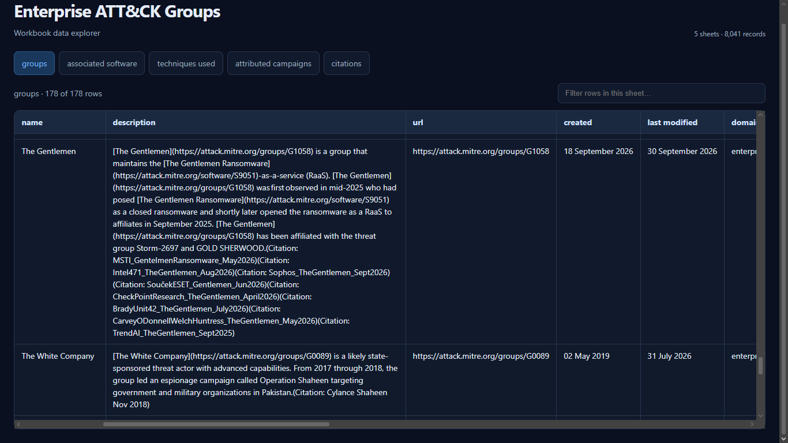

```
██████╗  █████╗ ███╗   ██╗███████╗ ██████╗ ███╗   ███╗██╗    ██╗ █████╗ ██████╗ ███████╗   ██╗     ██╗██╗   ██╗███████╗
██╔══██╗██╔══██╗████╗  ██║██╔════╝██╔═══██╗████╗ ████║██║    ██║██╔══██╗██╔══██╗██╔════╝   ██║     ██║██║   ██║██╔════╝
██████╔╝███████║██╔██╗ ██║███████╗██║   ██║██╔████╔██║██║ █╗ ██║███████║██████╔╝█████╗     ██║     ██║██║   ██║█████╗
██╔══██╗██╔══██║██║╚██╗██║╚════██║██║   ██║██║╚██╔╝██║██║███╗██║██╔══██║██╔══██╗██╔══╝     ██║     ██║╚██╗ ██╔╝██╔══╝
██║  ██║██║  ██║██║ ╚████║███████║╚██████╔╝██║ ╚═╝ ██║╚███╔███╔╝██║  ██║██║  ██║███████╗██╗███████╗██║ ╚████╔╝ ███████╗
╚═╝  ╚═╝╚═╝  ╚═╝╚═╝  ╚═══╝╚══════╝ ╚═════╝ ╚═╝     ╚═╝ ╚══╝╚══╝ ╚═╝  ╚═╝╚═╝  ╚═╝╚══════╝╚═╝╚══════╝╚═╝  ╚═══╝  ╚══════╝
Non nobis, sed securitati communi

version v202609 (Underground Economy '26 edition) 
by Julien Mousqueton
  Contact: @Julien.io on BlueSky
```
# ethical-hacking-basics
# Ethical Hacking Basics - *Video Course (8 Modules)*
## Att&ck Mitre: enterprise attack groups v20.0
## View the RAW file (approximately 5.27MBs) or Download the [enterprise-attack-groups-dark-standalone.html](https://github.com/ronnie-depp/ethical-hacking-basics/blob/main/enterprise-attack-groups-dark-standalone.html) standalone Dark Theme HTML file with embedded JSON exported for each of the 5 sheets in Excel Workbook and shown in horizontally scroll-able table for each sheet as HTML Tab.
### Converted XLSX workbook to sheet-wise JSON and embedded in Dark Themed standalone html from [Attack.Mitre.org](https://attack.mitre.org/docs/attack-excel-files/v20.0/enterprise-attack/enterprise-attack-v20.0.xlsx)

**TheGentlemen** RaaS *Ransomeware-as-Service* & **The White Company** attacked Pakistani Organisations in their *Operation Shaheen*.
